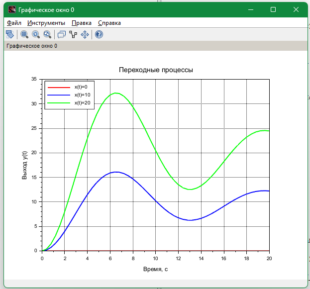
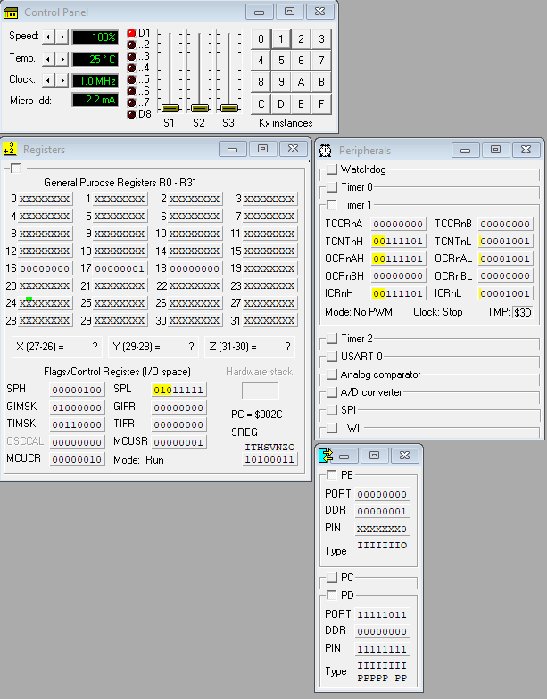
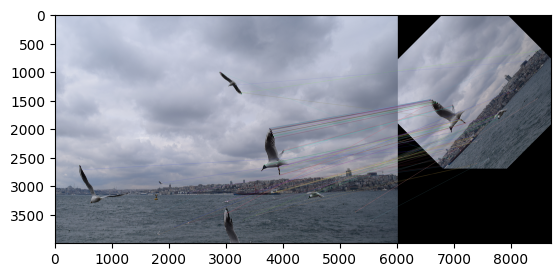

# University Labs

[Русская версия](README.md)

Labs, practice tasks, coursework and homework from 2022–2026, grouped by language. Every folder has its own README: what is inside, how to run it and what came out. Some of the work was done in a team or in a pair.

| Folder | Language and tools | Contents | Year |
|---|---|---|---|
| [`c-cpp/first-year`](c-cpp/first-year) | C, C++ | First-year labs: arrays, dynamic matrices, pointers, strings, C++ classes and a console menu that writes to a file | 2022–2023 |
| [`c-cpp/rtos-pthreads`](c-cpp/rtos-pthreads) | C, POSIX threads | Real-time systems: mutexes, signals, dining philosophers, a production line and a message queue on semaphores | 2024 |
| [`c-cpp/plc-automation-studio`](c-cpp/plc-automation-studio) | C, B&R Automation Studio | A model of two DC motors and a PI controller for a B&R PLC | 2025 |
| [`assembler/avr-atmega8`](assembler/avr-atmega8) | AVR assembler, VMLAB | ATmega8: 16 × 16-bit multiplication, an LED on the INT0 interrupt, a multiplexed seven-segment display on Timer 1 | 2025 |
| [`octave/signal-coding`](octave/signal-coding) | GNU Octave | Information transmission: spectrum, BPSK over a noisy channel, Huffman, Shannon–Fano and Hamming codes, packet retransmission | 2024 |
| [`scilab/control-theory`](scilab/control-theory) | Scilab, Xcos | Control theory: coursework on a pulse control system, frequency responses, a PID loop in Xcos | 2024–2025 |
| [`python/opencv-dnn-detection`](python/opencv-dnn-detection) | Python, OpenCV | YOLOv4 detection and Mask R-CNN segmentation through the OpenCV DNN module, FPS measurement | 2024 |
| [`python/ai-methods`](python/ai-methods) | Python | Finite-state machines: agent behavior and the Game of Life, parsing a log with regular expressions | 2025 |
| [`python/robot-modeling`](python/robot-modeling) | Python | Inverse kinematics of a two-link arm on a U-shaped path | 2025 |
| [`python/cv-image-processing`](python/cv-image-processing) | Python, OpenCV | Noise and filters, histograms, rotation, ORB keypoints and matching | 2026 |
| [`databases`](databases) | SQL, UML | Designing an information system (UML and ER) and a MySQL schema for a home rental service | 2024–2025 |

<table>
  <tr>
    <td></td>
    <td></td>
    <td></td>
  </tr>
  <tr>
    <td align="center">Transient responses of the pulse control system in Scilab</td>
    <td align="center">The INT0 interrupt on ATmega8 in VMLAB</td>
    <td align="center">ORB keypoints in OpenCV</td>
  </tr>
</table>

Code comments and plot labels are mostly in Russian.

## Tech stack

C, C++, POSIX threads, B&R Automation Studio, AVR assembler, GNU Octave, Scilab and Xcos, Python (NumPy, pandas, Matplotlib, Plotly, OpenCV), MySQL, draw.io.

## License

[MIT](LICENSE)
