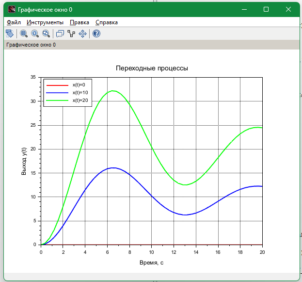
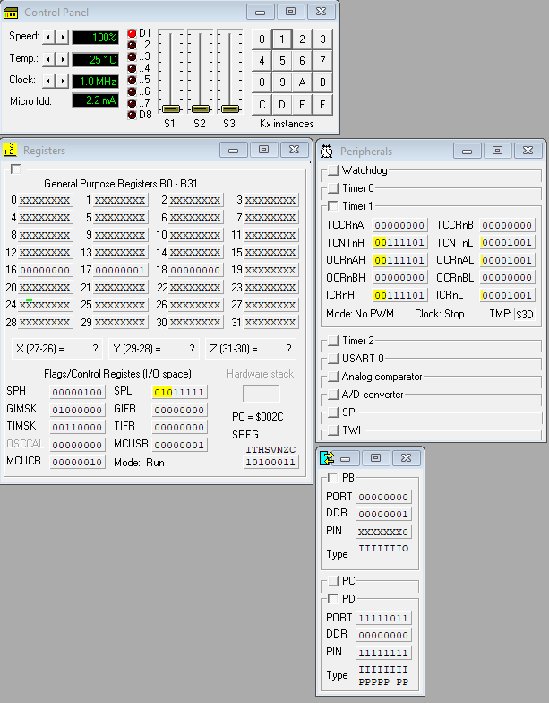
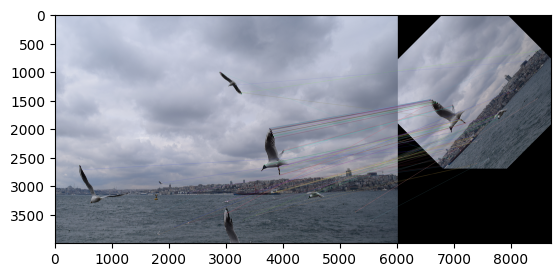

# Учебные работы

[English version](README.en.md)

Лабораторные, практики, курсовая и домашние задания 2022–2026 годов, разложенные по языкам. В каждой папке свой README: что внутри, как запустить и что получилось. Часть работ выполнялась в команде или в паре.

| Папка | Язык и среда | Что внутри | Год |
|---|---|---|---|
| [`c-cpp/first-year`](c-cpp/first-year) | C, C++ | Лабораторные первого курса: массивы, динамические матрицы, указатели, строки, классы C++ и консольное меню с записью в файл | 2022–2023 |
| [`c-cpp/rtos-pthreads`](c-cpp/rtos-pthreads) | C, POSIX threads | Системы реального времени: мьютексы, сигналы, обедающие философы, производственная линия и очередь сообщений на семафорах | 2024 |
| [`c-cpp/plc-automation-studio`](c-cpp/plc-automation-studio) | C, B&R Automation Studio | Модель двух двигателей постоянного тока и ПИ-регулятор для ПЛК B&R | 2025 |
| [`assembler/avr-atmega8`](assembler/avr-atmega8) | Ассемблер AVR, VMLAB | ATmega8: умножение 16 × 16 бит, светодиод по прерыванию INT0, динамическая индикация на таймере 1 | 2025 |
| [`octave/signal-coding`](octave/signal-coding) | GNU Octave | Передача информации: спектр, BPSK в канале с шумом, коды Хаффмана, Шеннона–Фано и Хэмминга, переотправка пакетов | 2024 |
| [`scilab/control-theory`](scilab/control-theory) | Scilab, Xcos | ТАУ: курсовая по импульсной системе управления, частотные характеристики, ПИД-регулятор в Xcos | 2024–2025 |
| [`python/opencv-dnn-detection`](python/opencv-dnn-detection) | Python, OpenCV | Детекция YOLOv4 и сегментация Mask R-CNN через модуль OpenCV DNN, замер FPS | 2024 |
| [`python/ai-methods`](python/ai-methods) | Python | Конечные автоматы: поведение агента и «Игра жизнь», разбор журнала регулярными выражениями | 2025 |
| [`python/robot-modeling`](python/robot-modeling) | Python | Обратная кинематика двухзвенного манипулятора на П-образной траектории | 2025 |
| [`python/cv-image-processing`](python/cv-image-processing) | Python, OpenCV | Шумы и фильтры, гистограммы, повороты, ключевые точки ORB и их сопоставление | 2026 |
| [`databases`](databases) | SQL, UML | Проектирование информационной системы (UML и ER) и схема MySQL для сервиса аренды жилья | 2024–2025 |

<table>
  <tr>
    <td></td>
    <td></td>
    <td></td>
  </tr>
  <tr>
    <td align="center">Переходные процессы импульсной САУ в Scilab</td>
    <td align="center">Прерывание INT0 на ATmega8 в VMLAB</td>
    <td align="center">Ключевые точки ORB в OpenCV</td>
  </tr>
</table>

## Стек

C, C++, POSIX threads, B&R Automation Studio, ассемблер AVR, GNU Octave, Scilab и Xcos, Python (NumPy, pandas, Matplotlib, Plotly, OpenCV), MySQL, draw.io.

## Лицензия

[MIT](LICENSE)
