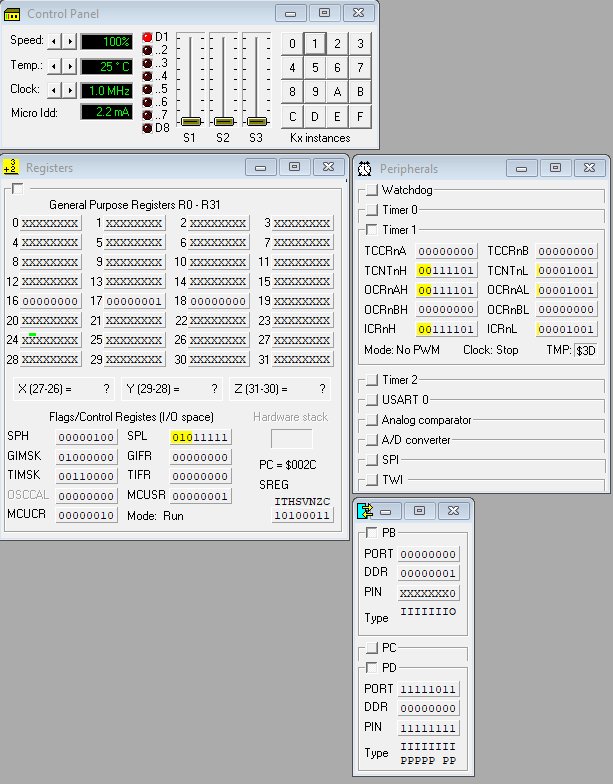
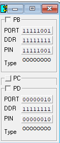

# AVR Assembler Labs on ATmega8

[Русская версия](README.md)

Microprocessor labs (February–May 2025): AVR assembler for the ATmega8, debugged in the VMLAB simulator. Some of the labs were done in pairs.

## Programs

| File | What it does |
|---|---|
| `my_idea.asm` | First experiments: 16-bit addition with `add` and `adc` |
| `lab1.asm` | 16 × 16-bit multiplication with `mul` by summing partial products, 32-bit result in R19:R18:R17:R16 |
| `lab2.asm` | Toggles an LED on PB0 with a button on PD2: falling-edge INT0 interrupt and a ~30 ms debounce delay |
| `lab3.asm` | Dynamic display of numbers on seven-segment indicators: Timer 1 in compare mode drives the scanning, plus the INT0 external interrupt |

The `.prj` files are VMLAB projects: the microcontroller, the clock and the attached peripherals.

<table>
  <tr>
    <td></td>
    <td></td>
  </tr>
  <tr>
    <td align="center">Lab 2 in VMLAB: control panel, registers, peripherals and ports</td>
    <td align="center">Ports B and D during dynamic display (lab 3)</td>
  </tr>
</table>

Code comments are in Russian.

## Tech stack

AVR Assembler, ATmega8, VMLAB 3.15.

## Quick start

Open a `.prj` file in VMLAB. The sources include `C:\VMLAB\include\m8def.inc` from a standard VMLAB installation.

## License

[MIT](../../LICENSE)
