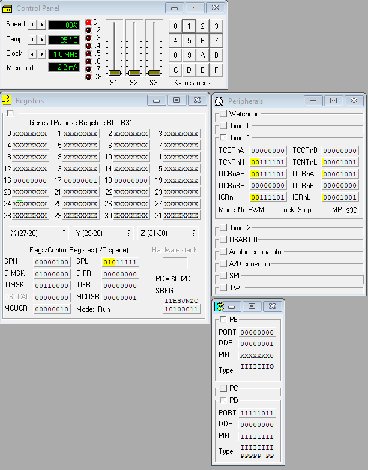
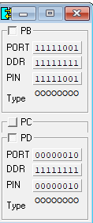

# Ассемблер AVR: лабораторные на ATmega8

[English version](README.en.md)

Лабораторные по микропроцессорной технике (февраль–май 2025): ассемблер AVR для ATmega8 с отладкой в симуляторе VMLAB. Часть работ выполнялась в паре.

## Программы

| Файл | Что делает |
|---|---|
| `my_idea.asm` | Первые эксперименты: сложение 16-битных чисел командами `add` и `adc` |
| `lab1.asm` | Умножение 16 × 16 бит через `mul` со сложением частичных произведений, 32-битный результат в R19:R18:R17:R16 |
| `lab2.asm` | Переключение светодиода на PB0 по кнопке на PD2: внешнее прерывание INT0 по спаду и задержка ~30 мс против дребезга |
| `lab3.asm` | Динамическая индикация чисел на семисегментных индикаторах: развёртку задаёт таймер 1 в режиме сравнения, используется внешнее прерывание INT0 |

Файлы `.prj` описывают проекты VMLAB: микроконтроллер, тактовую частоту и подключённую периферию.

<table>
  <tr>
    <td></td>
    <td></td>
  </tr>
  <tr>
    <td align="center">Лабораторная 2 в VMLAB: панель управления, регистры, периферия и порты</td>
    <td align="center">Порты B и D при динамической индикации (лабораторная 3)</td>
  </tr>
</table>

## Стек

AVR Assembler, ATmega8, VMLAB 3.15.

## Запуск

Откройте нужный `.prj` в VMLAB. Исходники подключают `C:\VMLAB\include\m8def.inc` из стандартной установки VMLAB.

## Лицензия

[MIT](../../LICENSE)
