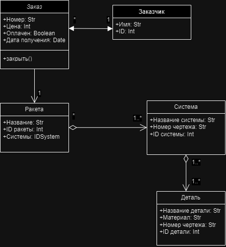
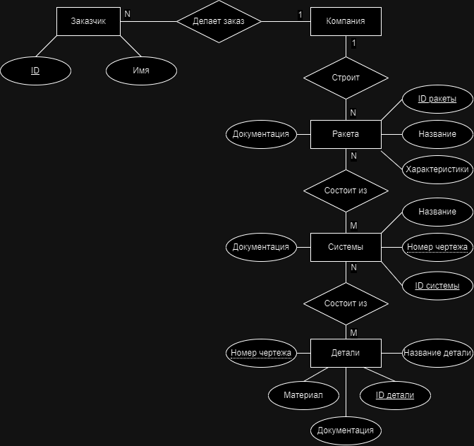

# Databases: Design and SQL

[Русская версия](README.md)

## Information system design (`design/`, May–June 2024)

An information system for a company that builds rockets to order:
- use case, class, sequence and activity diagrams;
- an ER diagram in Chen notation.

The class, sequence, activity and ER diagrams are drawn in draw.io, with the sources next to the images. The use case diagrams and the second version of the activity diagram survive only as images.

<table>
  <tr>
    <td></td>
    <td></td>
  </tr>
  <tr>
    <td align="center">Class diagram</td>
    <td align="center">ER diagram in Chen notation</td>
  </tr>
</table>

Diagram labels are in Russian.

## SQL (`sql/`, October 2025)

- `rental_schema.sql`: a MySQL schema for a home rental service: users, listings, bookings and reviews.
- `rental_queries.sql`: the bookings for a chosen week.

## Tech stack

MySQL, draw.io, Visual Paradigm.

## License

[MIT](../LICENSE)
