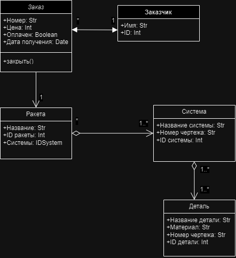
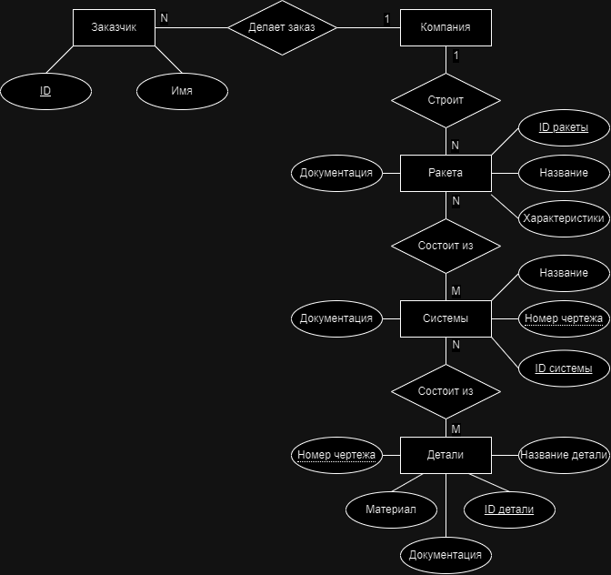

# Базы данных: проектирование и SQL

[English version](README.en.md)

## Проектирование информационной системы (`design/`, май–июнь 2024)

Информационная система компании, которая собирает ракеты на заказ:
- диаграммы вариантов использования, классов, последовательности и деятельности;
- ER-диаграмма в нотации Чена.

Диаграммы классов, последовательности и деятельности и ER-диаграмма нарисованы в draw.io, исходники лежат рядом с картинками. Диаграммы вариантов использования и второй вариант диаграммы деятельности сохранились только картинками.

<table>
  <tr>
    <td></td>
    <td></td>
  </tr>
  <tr>
    <td align="center">Диаграмма классов</td>
    <td align="center">ER-диаграмма в нотации Чена</td>
  </tr>
</table>

## SQL (`sql/`, октябрь 2025)

- `rental_schema.sql`: схема MySQL для сервиса аренды жилья: пользователи, объявления, бронирования и отзывы.
- `rental_queries.sql`: бронирования за выбранную неделю.

## Стек

MySQL, draw.io, Visual Paradigm.

## Лицензия

[MIT](../LICENSE)
