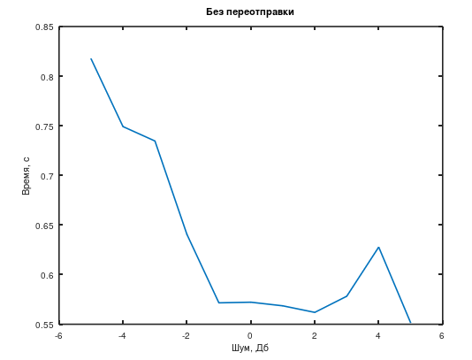
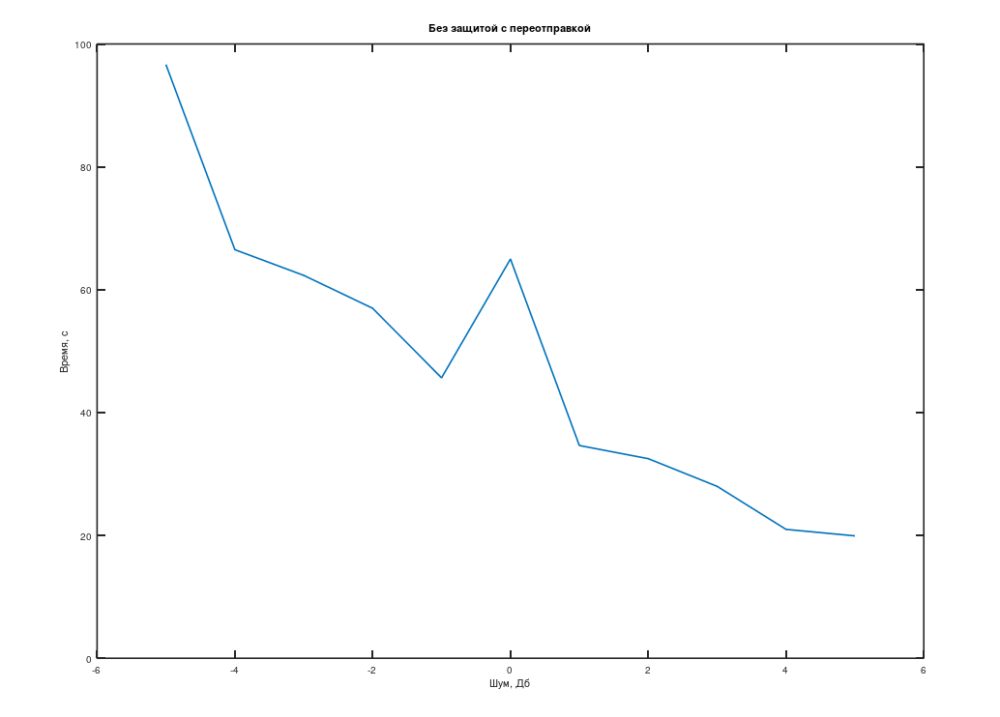
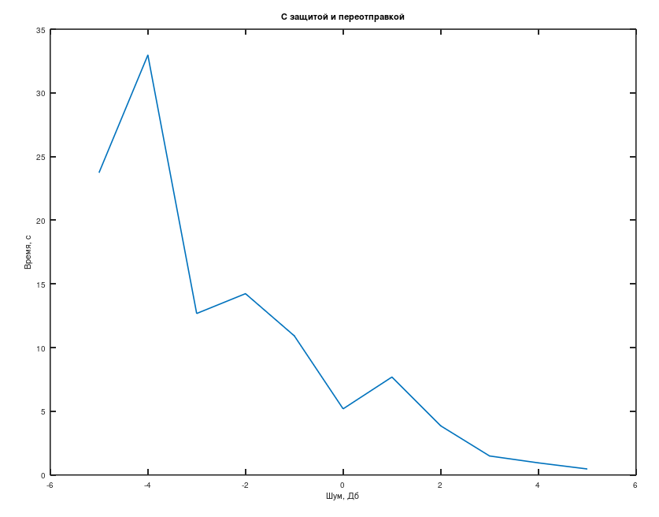

# Information Transmission: Coding and Noise Immunity in Octave

[Русская версия](README.md)

Practice and lab assignments for the course "Information Transmission in Real-Time Systems" (April–May 2024), written in GNU Octave with the `signal` and `communications` packages.

## Assignments

| File | Contents |
|---|---|
| `prak1.m` | Signal spectrum via FFT: magnitude and phase |
| `prak2.m` | Resampling a sum of two cosines from 1000 to 3000 Hz |
| `laba2.m` | Bit error rate (BER) of BPSK over an AWGN channel: simulation against theory (`erfc`) for Eb/N0 from −5 to 5 dB |
| `prak4.m` | Binary symmetric channel: the built-in `bsc` against a custom implementation, error statistics for different data sizes |
| `prak5.m` | Huffman coding of a phrase: building the tree and encoding |
| `prak6.m` | Hamming (15, 11) code: generator and parity-check matrices, encoding, error correction |
| `laba3.m` | Shannon–Fano coding, a Hamming code and BPSK: BER versus SNR |
| `zadanie4_laba.m` | Lab 4: Shannon–Fano, a cyclic (7, 4) code, BPSK and AWGN noise. Transfer time without retransmission, with retransmission, and with protection plus retransmission for SNR from −5 to 5 dB |

## Lab 4 results

<table>
  <tr>
    <td></td>
    <td></td>
    <td></td>
  </tr>
  <tr>
    <td align="center">No retransmission</td>
    <td align="center">Retransmission, no protection</td>
    <td align="center">Protection and retransmission</td>
  </tr>
</table>

The X axis is the noise level in dB, the Y axis is the transfer time in seconds. Plot labels are in Russian, as in the original work.

## Tech stack

GNU Octave with the `signal` and `communications` packages.

## Quick start

```octave
pkg install -forge signal communications
pkg load signal communications
zadanie4_laba
```

## License

[MIT](../../LICENSE)
