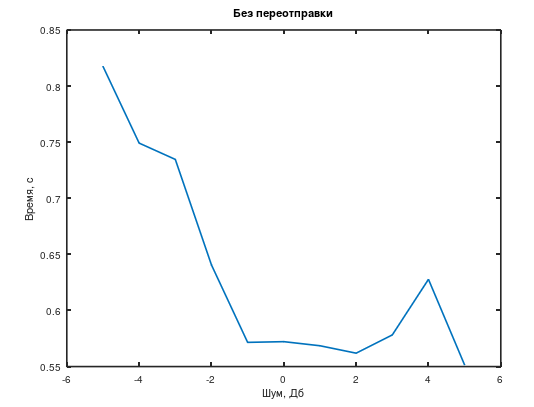
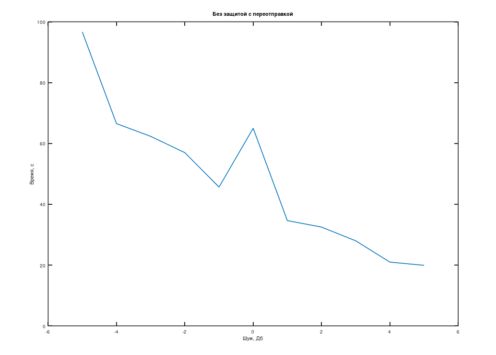
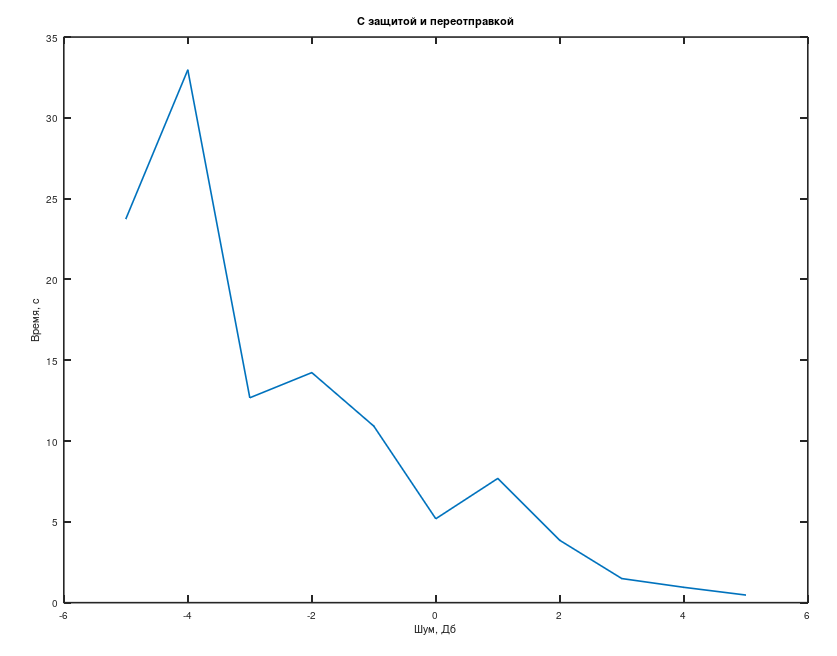

# Передача информации: кодирование и помехоустойчивость в Octave

[English version](README.en.md)

Практические и лабораторные по курсу «Передача информации в системах реального времени» (апрель–май 2024) на GNU Octave с пакетами `signal` и `communications`.

## Работы

| Файл | Что внутри |
|---|---|
| `prak1.m` | Спектр сигнала через БПФ: амплитуда и фаза |
| `prak2.m` | Ресемплинг суммы двух косинусоид с 1000 до 3000 Гц |
| `laba2.m` | Вероятность битовой ошибки (BER) для BPSK в канале с белым шумом: моделирование против теории (`erfc`) при Eb/N0 от −5 до 5 дБ |
| `prak4.m` | Двоичный симметричный канал: встроенный `bsc` против своей реализации, статистика ошибок для разных объёмов данных |
| `prak5.m` | Код Хаффмана для фразы: построение дерева и кодирование |
| `prak6.m` | Код Хэмминга (15, 11): порождающая и проверочная матрицы, кодирование, исправление ошибки |
| `laba3.m` | Код Шеннона–Фано, код Хэмминга и BPSK: BER в зависимости от SNR |
| `zadanie4_laba.m` | Лабораторная 4: Шеннон–Фано, циклический код (7, 4), BPSK и шум AWGN. Время передачи без переотправки, с переотправкой и с защитой и переотправкой при SNR от −5 до 5 дБ |

## Результаты лабораторной 4

<table>
  <tr>
    <td></td>
    <td></td>
    <td></td>
  </tr>
  <tr>
    <td align="center">Без переотправки</td>
    <td align="center">С переотправкой, без защиты</td>
    <td align="center">С защитой и переотправкой</td>
  </tr>
</table>

По оси X уровень шума в дБ, по оси Y время передачи в секундах.

## Стек

GNU Octave, пакеты `signal` и `communications`.

## Запуск

```octave
pkg install -forge signal communications
pkg load signal communications
zadanie4_laba
```

## Лицензия

[MIT](../../LICENSE)
