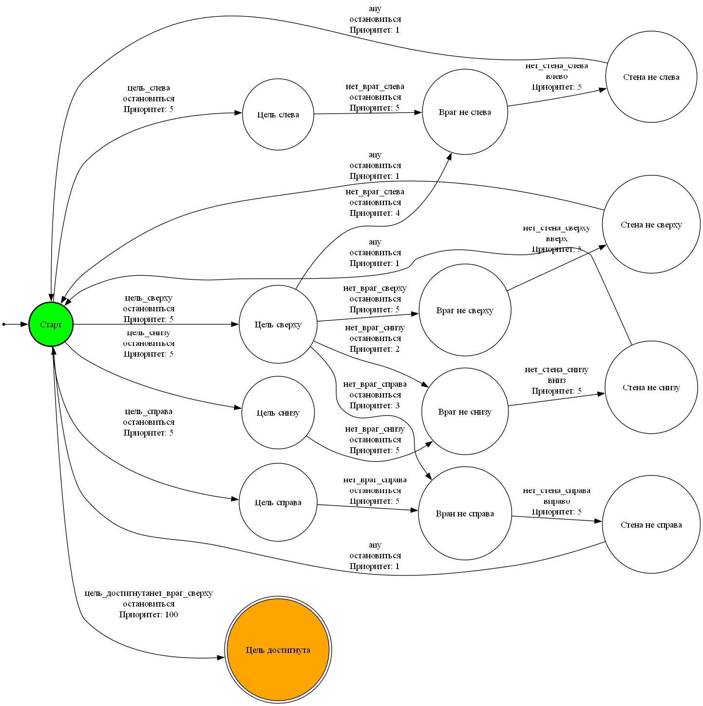

# Artificial Intelligence Methods: Finite-State Machines

[Русская версия](README.md)

Practice tasks for the artificial intelligence methods course (February–March 2025).

| File | Contents |
|---|---|
| `finite_automaton/` | A finite-state machine for an agent's behavior. The states come from sensor readings (wall, enemy and goal on different sides) in `automaton.json`, with a diagram of the machine next to it |
| `log_regex.ipynb` | Parsing server log lines with regular expressions. The log itself is not included |
| `game_of_life_fsm.ipynb` | The Game of Life on a 250 × 250 grid. Every cell is a finite-state machine, animated in Matplotlib |

<p align="center"><br>The agent behavior state machine (labels in Russian)</p>

## Quick start

```bash
pip install matplotlib jupyter
jupyter notebook game_of_life_fsm.ipynb
```

## Tech stack

Python, Matplotlib, regular expressions (`re`), Jupyter.

## License

[MIT](../../LICENSE)
