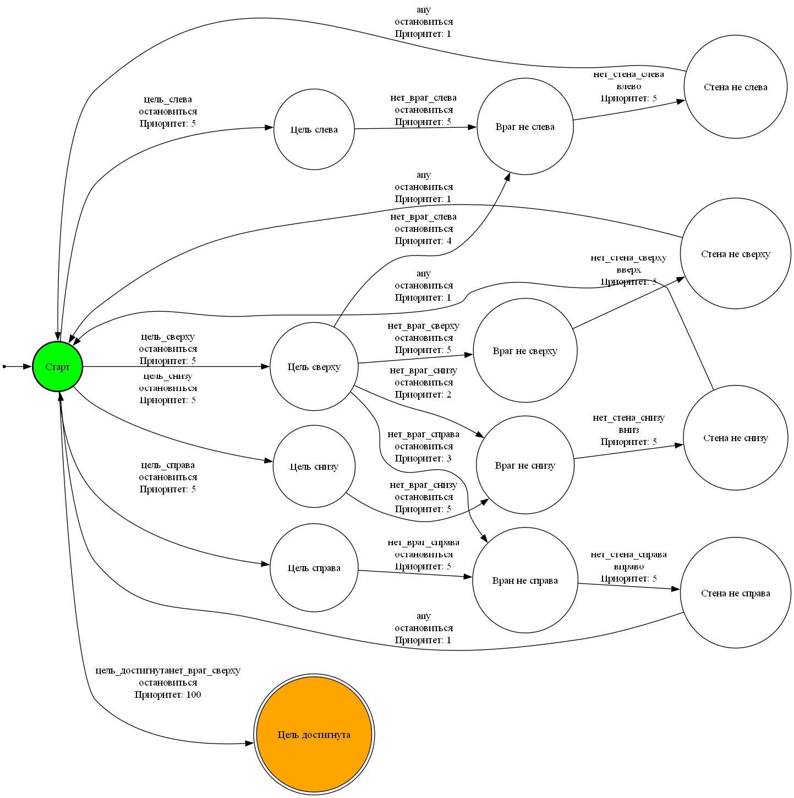

# Методы искусственного интеллекта: конечные автоматы

[English version](README.en.md)

Практики по методам искусственного интеллекта (февраль–март 2025).

| Файл | Что внутри |
|---|---|
| `finite_automaton/` | Конечный автомат поведения агента. Состояния заданы по показаниям датчиков (стена, враг и цель с разных сторон) в `automaton.json`, рядом схема автомата |
| `log_regex.ipynb` | Разбор строк журнала сервера регулярными выражениями. Сам журнал в репозиторий не входит |
| `game_of_life_fsm.ipynb` | «Игра жизнь» на сетке 250 × 250. Каждая клетка устроена как конечный автомат, анимация в Matplotlib |

<p align="center"><br>Схема автомата поведения агента</p>

## Запуск

```bash
pip install matplotlib jupyter
jupyter notebook game_of_life_fsm.ipynb
```

## Стек

Python, Matplotlib, регулярные выражения (`re`), Jupyter.

## Лицензия

[MIT](../../LICENSE)
