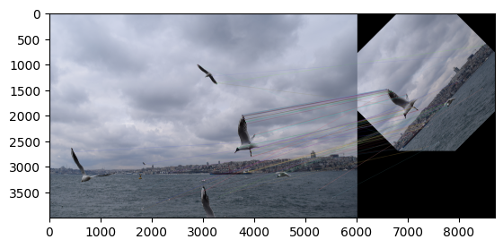
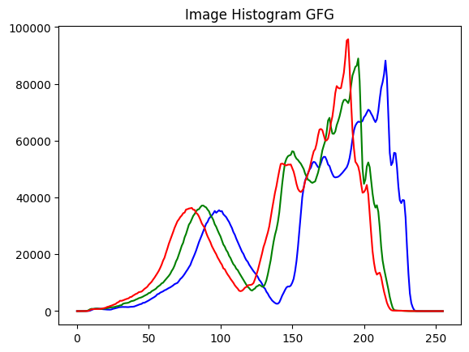

# Computer Vision: Image Processing with OpenCV

[Русская версия](README.md)

Two computer vision homework assignments (October 2026), done in a pair.

| Notebook | Contents |
|---|---|
| `hw1.ipynb` | Impulse and salt-and-pepper noise, blur, sharpening, median filter, brightness and RGB channel histograms |
| `hw2.ipynb` | Downscaling an image by 10%, cropping, rotation with `getRotationMatrix2D` and `warpAffine`, ORB keypoints and `BFMatcher` matching between the original and the rotated image |

<table>
  <tr>
    <td></td>
    <td></td>
  </tr>
  <tr>
    <td align="center">ORB keypoint matching between the original and the rotated photo</td>
    <td align="center">Image channel histogram</td>
  </tr>
</table>

Notebook text is in Russian.

## Quick start

```bash
pip install -r requirements.txt
jupyter notebook hw1.ipynb
```

The source photos are not included. To re-run the notebooks, put your own images with the names used in the code (`cat.JPG`, `sea.JPG`) next to them. Outputs from the previous run are kept in the notebooks.

## Tech stack

Python, OpenCV, NumPy, Matplotlib, Pillow.

## License

[MIT](../../LICENSE)
