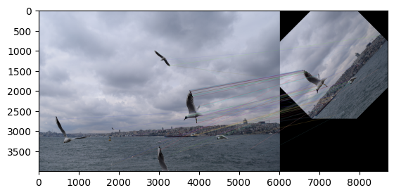
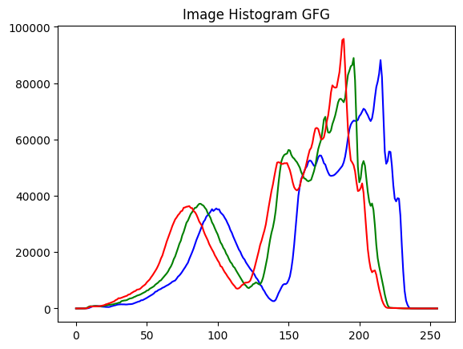

# Компьютерное зрение: обработка изображений в OpenCV

[English version](README.en.md)

Два домашних задания по компьютерному зрению (октябрь 2026), выполнены в паре.

| Ноутбук | Что внутри |
|---|---|
| `hw1.ipynb` | Импульсный шум и шум «соль-перец», размытие, повышение резкости, медианный фильтр, гистограммы яркости и каналов RGB |
| `hw2.ipynb` | Уменьшение изображения на 10 %, обрезка, поворот через `getRotationMatrix2D` и `warpAffine`, ключевые точки ORB и их сопоставление `BFMatcher` между исходным и повёрнутым изображением |

<table>
  <tr>
    <td></td>
    <td></td>
  </tr>
  <tr>
    <td align="center">Сопоставление ключевых точек ORB между исходным и повёрнутым снимком</td>
    <td align="center">Гистограмма каналов изображения</td>
  </tr>
</table>

## Запуск

```bash
pip install -r requirements.txt
jupyter notebook hw1.ipynb
```

Исходные фотографии в репозиторий не входят. Чтобы перезапустить ноутбуки, положите рядом свои изображения с именами из кода (`cat.JPG`, `sea.JPG`). Результаты прошлого запуска сохранены в ноутбуках.

## Стек

Python, OpenCV, NumPy, Matplotlib, Pillow.

## Лицензия

[MIT](../../LICENSE)
