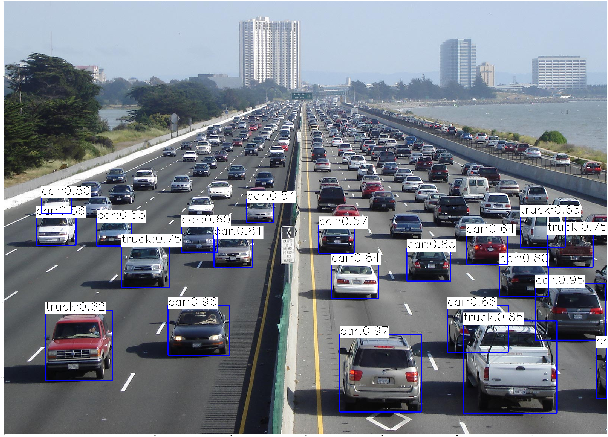

# Object Detection with OpenCV DNN

[Русская версия](README.md)

Computer vision exercises from an elite study group (November 2024): ready-made detection and segmentation models run through the OpenCV DNN module.

| File | What it does |
|---|---|
| `yolo_photo.py` | YOLOv4 (Darknet weights) through `cv2.dnn_DetectionModel`: COCO objects in a photo with boxes and confidence |
| `yolo_video.py` | The same in real time from a webcam |
| `Mask.py` | Mask R-CNN Inception v2 (a frozen TensorFlow graph) through `readNetFromTensorflow`: object boxes and masks |
| `detection_experiments.ipynb` | Experiments with the same models and a detection speed (FPS) measurement |

<p align="center"><br>YOLOv4 on a highway photo</p>

## Models

Model weights and configs are not included; download them and put them next to the scripts:
- `yolov4.cfg`, `yolov4.weights` and `coco.names`: [AlexeyAB/darknet](https://github.com/AlexeyAB/darknet);
- `frozen_inference_graph_coco.pb` (the `mask_rcnn_inception_v2_coco_2018_01_28` archive): [TensorFlow 1 Detection Model Zoo](https://github.com/tensorflow/models/blob/master/research/object_detection/g3doc/tf1_detection_zoo.md);
- `mask_rcnn_inception_v2_coco_2018_01_28.pbtxt`: [opencv/opencv_extra](https://github.com/opencv/opencv_extra/tree/master/testdata/dnn).

## Quick start

```bash
pip install opencv-python numpy matplotlib tqdm
python yolo_photo.py
```

The scripts open an image by the name used in the code (`cars.jpg`, `human_detection.jpg`); the source photos are not included.

## Tech stack

Python, OpenCV DNN, YOLOv4, Mask R-CNN, NumPy, Matplotlib.

## License

[MIT](../../LICENSE)
