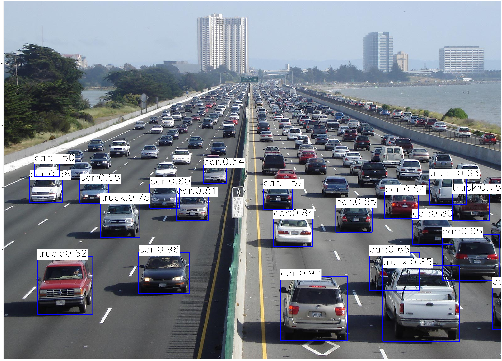

# Детекция объектов через OpenCV DNN

[English version](README.en.md)

Упражнения элитной группы по компьютерному зрению (ноябрь 2024): готовые модели детекции и сегментации запускаются через модуль OpenCV DNN.

| Файл | Что делает |
|---|---|
| `yolo_photo.py` | YOLOv4 (веса Darknet) через `cv2.dnn_DetectionModel`: объекты COCO на фото, рамки и уверенность |
| `yolo_video.py` | То же в реальном времени с веб-камеры |
| `Mask.py` | Mask R-CNN Inception v2 (замороженный граф TensorFlow) через `readNetFromTensorflow`: рамки и маски объектов |
| `detection_experiments.ipynb` | Эксперименты с теми же моделями и замер скорости детекции (FPS) |

<p align="center"><br>YOLOv4 на снимке шоссе</p>

## Модели

Веса и конфигурации моделей в репозиторий не входят, их нужно скачать и положить рядом со скриптами:
- `yolov4.cfg`, `yolov4.weights` и `coco.names`: [AlexeyAB/darknet](https://github.com/AlexeyAB/darknet);
- `frozen_inference_graph_coco.pb` (архив `mask_rcnn_inception_v2_coco_2018_01_28`): [TensorFlow 1 Detection Model Zoo](https://github.com/tensorflow/models/blob/master/research/object_detection/g3doc/tf1_detection_zoo.md);
- `mask_rcnn_inception_v2_coco_2018_01_28.pbtxt`: [opencv/opencv_extra](https://github.com/opencv/opencv_extra/tree/master/testdata/dnn).

## Запуск

```bash
pip install opencv-python numpy matplotlib tqdm
python yolo_photo.py
```

Скрипты открывают изображение по имени из кода (`cars.jpg`, `human_detection.jpg`), исходные фото в репозиторий не входят.

## Стек

Python, OpenCV DNN, YOLOv4, Mask R-CNN, NumPy, Matplotlib.

## Лицензия

[MIT](../../LICENSE)
