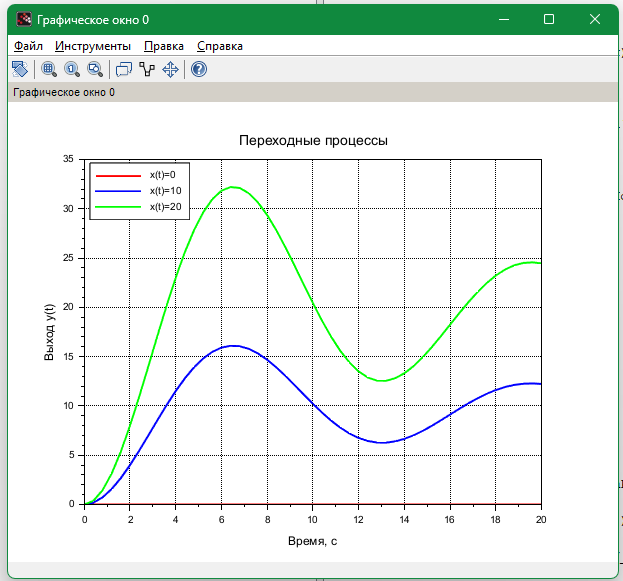
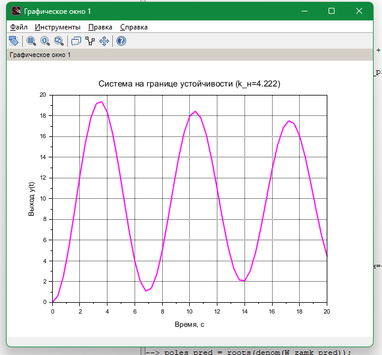
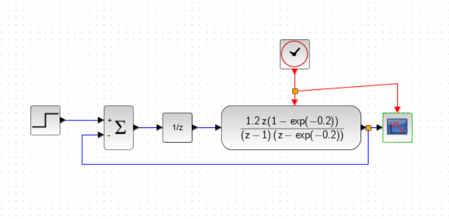

# Control Theory in Scilab

[Русская версия](README.md)

Coursework "Analysis of a pulse control system" (October 2025) and control theory labs (fall 2024), done in Scilab and Xcos.

## Coursework: a pulse (discrete-time) control system

`coursework/kr_tay.sci`, variant 7:
- the open-loop discrete transfer function W(z) = k · (−5 + 0.4/(z − 1) + 5(z − 1)/(z − a)), where a = e^(−0.04) and the sampling period T = 0.2 s, plus the closed loop W/(1 + W);
- stability from the magnitudes of the denominator roots;
- step responses for constant inputs, steady-state value, error and overshoot;
- behavior at the stability boundary, k = 4.222;
- frequency response (`bode`).

Plots are saved to PNG with `xs2png`.

<table>
  <tr>
    <td></td>
    <td></td>
  </tr>
  <tr>
    <td align="center">Step responses for different inputs</td>
    <td align="center">The system at the stability boundary (k = 4.222)</td>
  </tr>
</table>

<p align="center"><br>The pulse control system in Xcos</p>

Plot labels are in Russian, as in the original work.

## Labs

| File | Contents |
|---|---|
| `labs/laba1.sci` | A third-order system W(s) = 1/(s³ + 1.5s² + 2s + 1): step response, poles, Nyquist plot, Bode plots |
| `labs/lab4.zcos` | An Xcos model: a loop with a PID controller and the output on a scope |

## Tech stack

Scilab, Xcos.

## Quick start

Start Scilab in the repository root and run:

```scilab
exec("coursework/kr_tay.sci", -1);
exec("labs/laba1.sci", -1);
```

`labs/lab4.zcos` opens in Xcos.

## License

[MIT](../../LICENSE)
