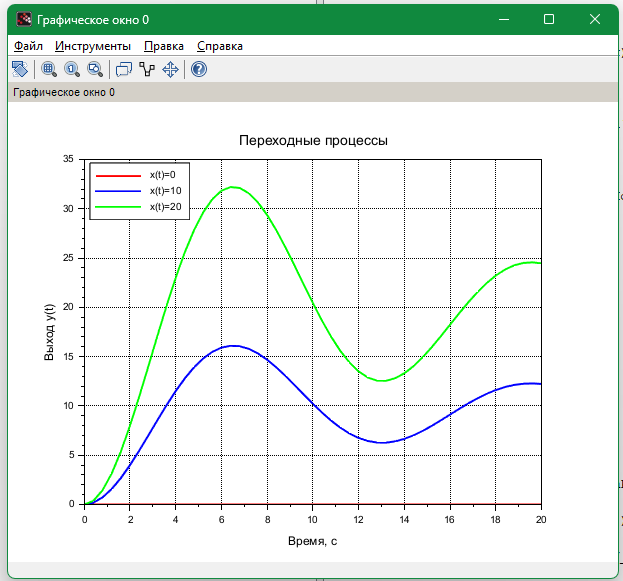
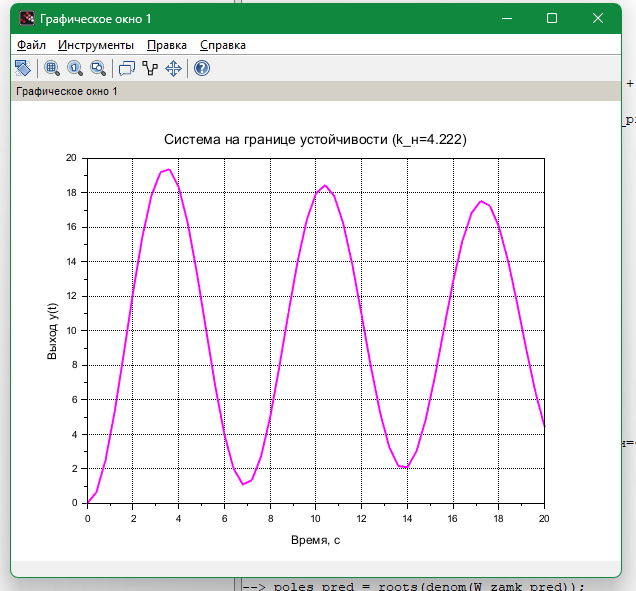
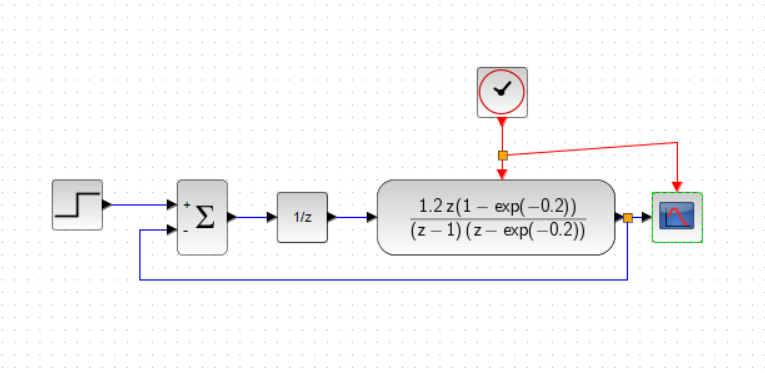

# Теория автоматического управления в Scilab

[English version](README.en.md)

Курсовая работа «Исследование импульсной САУ» (октябрь 2025) и лабораторные по ТАУ (осень 2024), сделанные в Scilab и Xcos.

## Курсовая: импульсная система управления

`coursework/kr_tay.sci`, вариант 7:
- передаточная функция разомкнутой дискретной системы W(z) = kн · (−5 + 0,4/(z − 1) + 5(z − 1)/(z − a)), где a = e^(−0,04) и период дискретизации T = 0,2 с, а также замкнутая система W/(1 + W);
- устойчивость по модулям корней знаменателя;
- переходные процессы при постоянных входных воздействиях, установившееся значение, ошибка и перерегулирование;
- поведение на границе устойчивости при kн = 4,222;
- частотные характеристики (`bode`).

Графики сохраняются в PNG через `xs2png`.

<table>
  <tr>
    <td></td>
    <td></td>
  </tr>
  <tr>
    <td align="center">Переходные процессы при разных входах</td>
    <td align="center">Система на границе устойчивости (kн = 4,222)</td>
  </tr>
</table>

<p align="center"><br>Схема импульсной системы в Xcos</p>

## Лабораторные

| Файл | Что внутри |
|---|---|
| `labs/laba1.sci` | Звено третьего порядка W(s) = 1/(s³ + 1,5s² + 2s + 1): переходная характеристика, корни, годограф Найквиста, ЛАЧХ и ЛФЧХ |
| `labs/lab4.zcos` | Модель Xcos: контур с ПИД-регулятором и наблюдением выхода на осциллографе |

## Стек

Scilab, Xcos.

## Запуск

Откройте Scilab в корне репозитория и выполните:

```scilab
exec("coursework/kr_tay.sci", -1);
exec("labs/laba1.sci", -1);
```

Модель `labs/lab4.zcos` открывается в Xcos.

## Лицензия

[MIT](../../LICENSE)
